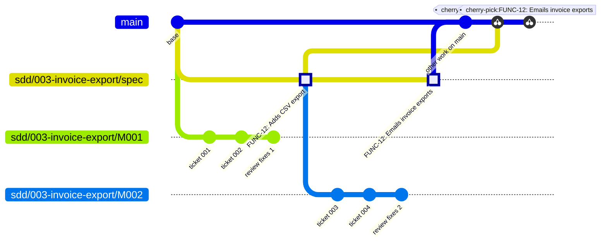

# alper-skills

Spec-driven agent skills for Claude Code, packaged as an installable plugin. They take a feature from a loose idea to reviewed, committed code: you brainstorm it, write it down as a spec, cut the spec into tickets, and build the tickets test-first. You make the decisions. The agent does the digging, writing and building.

## Install

```
/plugin marketplace add alexandrecsp/skills
/plugin install alper-skills@alper
```

The skills then show up as `/alper-skills:<name>`. Below they are written by their short names.

## The pipeline

```
/setup-repository          once per repo: creates .sdd/
        │
/brainstorm  ──────────────  a shared understanding: What, then How
        │
/to-spec  ─────────────────  .sdd/specs/NNN-<slug>/spec.md
        │
/to-tickets  ──────────────  milestones/NNN-<milestone>/ with tickets
        │
/build  (once per milestone, or all of them with auto) ┐
   ├─ branch sdd/<spec>/M<NNN> from sdd/<spec>/spec
   ├─ per ticket: sub-agent → tdd → commit
   ├─ check the milestone's "Done when"
   ├─ review-changes → arbiter decides escalations → fix
   └─ squash it into sdd/<spec>/spec ┘
        │
/build  (once every milestone is in)
   └─ rebase the spec onto the base → fast-forward the base
```

Each stage writes files the next one reads, and each ends by telling you the next command to run. You can stop between any two stages, or join partway through. For example, `/to-tickets` works on the current conversation without a spec, and `review-changes` works on any branch.

### 0. `/setup-repository`

Prepares the repo. It creates `.sdd/`, which holds everything the pipeline shares and is kept out of git, through `.gitignore` or, when that file can't change, `.git/info/exclude`:

```
.sdd/
├── settings.json    ← { "commitKeyPattern": "FUNC-\\d+" } or null
└── specs/
```

`commitKeyPattern` is the regex for an optional key at the start of every commit message, such as a ticket ID.

It also settles the repo's **layout** with `project-structure`. It detects each app's archetype (frontend, backend or full-stack) and writes `docs/STRUCTURE.md`, which is committed. In a repo that already has code, it records the layout the code uses; in an empty repo, it proposes the archetype's hexagonal layout. It then asks whether the repo uses `AGENTS.md` or `CLAUDE.md`, and writes a short **Spec workflow** section there pointing at `docs/STRUCTURE.md`, the glossary and ADRs, and `.sdd/specs/`, plus the commands of the repo's two suites: the **unit suite** (linter, typechecker, unit and integration tests) and the **e2e suite**. Implementers run the unit suite and only the e2e tests they write, by name; `build` runs both suites once per milestone, at its check. `build`'s implementers place and name files by `docs/STRUCTURE.md`, and `review-changes` reviews against it.

It is safe to run again: a rerun keeps everything already settled.

### 1. `/brainstorm [topic]`

The agent interviews you, one round of questions at a time, until you share an understanding of the work. The decisions form a **design tree** with two phases:

- **What** comes first: the problem, scope, behaviour, constraints and what success looks like.
- **How** comes second: the approach, architecture, data and design patterns (via `design-patterns`).

Each round asks every question that can be answered *now*, with options and a recommended answer, so replying `ok` accepts all the recommendations. When a question depends on a fact about the codebase, the agent looks it up instead of asking you. Each phase ends with a summary for you to confirm.

`/brainstorm-with-docs` runs the same interview together with `domain-modeling`. Terms are challenged against `GLOSSARY.md` and written down as they settle, and decisions that are hard to reverse are offered as ADRs in `docs/adr/`.

### 2. `/to-spec`

Turns the conversation into `.sdd/specs/NNN-<slug>/spec.md`. The spec contains only what the conversation settled. Each question left open comes with a recommended answer, for you to settle now or record as open. Before writing, the agent proposes two things for you to confirm:

- the **seams** where tests will prove the feature works, as few as possible
- the **design patterns**, if the brainstorm never weighed them

It also asks for the spec's commit key. The spec covers the problem, solution, user stories and out-of-scope items (the What), then implementation decisions, testing decisions and design patterns (the How).

When another **in-flight** spec (one not landed yet) changes the same modules, the new spec **depends on** it: it is designed against that spec's planned state, lists what it assumes under **Relies On**, and `/build` waits until the dependency lands and those assumptions still hold. A spec that will never be built carries an `**Abandoned:** <reason>` line: it stops counting as in-flight, `/build` refuses it, and the dashboard greys it out. The agent writes that line when you tell it an overlapping spec is dead, or you can add it by hand.

### 3. `/to-tickets [spec-id]`

Breaks the spec into ordered **milestones**, and each milestone into **tickets**:

- A milestone is an increment that leaves the code working and tested. It has a check the builder can run.
- A ticket is a **tracer bullet**: a thin vertical slice through every layer it needs, verifiable at a confirmed seam, and small enough for one agent with a fresh context. Prefactoring tickets come first. Wide mechanical refactors follow `WIDE-REFACTOR.md` so each batch stays green.

You review the breakdown (boundaries, granularity, dependencies) until you approve it. Then it writes:

```
.sdd/specs/NNN-<slug>/
├── spec.md
└── milestones/
    └── NNN-<milestone-slug>/
        ├── milestone.md        ← Delivers, Done when, Phase, Squash: <sha>
        ├── NNN-<ticket-slug>.md   ← Status: todo | doing | blocked | done, Commit: <sha>, Depends on, Notes
        └── review.md           ← written by review-changes: the findings, and the arbiter's answers to escalations
```

### 4. `/build [spec-id] [auto]`

A **spec id** is the spec folder's number (`3`), name or path. `/build` builds **one milestone per run**, or with `auto` every milestone and then the landing:

1. It picks the earliest milestone not yet squashed, and resumes it from its **Phase** line when an earlier build stopped partway.
2. It checks out the milestone's own branch, `sdd/<spec-folder>/M<NNN>`, created from the spec's branch, `sdd/<spec-folder>/spec`. The first milestone creates the spec's branch from the base branch and records the base in `spec.md`. The working tree must be clean.
3. For each ticket, in order, it starts a fresh **implementer sub-agent**. That sub-agent reads the ticket, the milestone, the spec, and the notes and commits of earlier tickets. It builds the ticket with `tdd` (red, then green, at the ticket's seams) and commits with `commit`. Then it marks the ticket `done` with its SHA and leaves notes for the next ticket.
4. It runs `review-changes` over the milestone's whole diff, from the branch's merge-base with the base, which saves its report as the milestone's `review.md`. Every finding is fixed automatically in one pass by a **fixer**, the implementer dispatched on Sonnet rather than Haiku, with no second review. Findings flagged **escalate** (fixes that would contradict an ADR, change an interface that code outside the diff already calls, or need the spec itself changed) go first to an **arbiter** sub-agent on Opus, which decides each one without asking you. A decision that departs from the spec is noted in the tickets it touches, and `spec.md` stays as you approved it. The hand-over lists every decision under **Decided for you**, so you can revert any of them.
5. It runs the full suite and the milestone's **Done when** check, once, after the fixes.
6. It squashes the milestone's branch into the spec's branch as one commit, recording its SHA in `milestone.md`.

Run `/build` again for the next milestone, or `/build <spec-id> auto` to build every remaining milestone and land the spec in one run: it reports one line per milestone and the full report at the end, and stops only where a single run would (a blocked ticket, a check it can't fix, the question before landing). Once every milestone is in, `/build` asks before landing the spec: it rebases the spec's branch onto the base, runs the full suite (fixing it, in up to two tries, when the base's new commits broke it), and fast-forwards the base. Everything stays local: nothing is pushed and no PR is opened, so push by hand when you want to. Because progress lives in the ticket files, the **Phase** line and `review.md`, a build that stops picks up where it left off.

#### Branches and merging



Each spec has its own branch, `sdd/<spec-folder>/spec`, cut from the base when its first milestone starts. Each milestone is one branch, `sdd/<spec-folder>/M<NNN>`, cut from the spec's branch and squashed back into it as one commit (highlighted). The next milestone branches from the spec's branch after that squash. The milestone branches are kept until the spec lands, so each ticket's **Commit** stays readable.

Once every milestone is in, the spec lands: `/build` rebases the spec's branch onto the base, then fast-forwards the base to it. The graph draws that rebase as cherry-picks: the base ends with one commit per milestone (plus a fix commit when the rebase broke the suite), in a straight line, with no merge commit, and never holds a half-built spec.

Every pipeline branch starts with `sdd/`, so `git branch --list 'sdd/*'` finds them all, and `git branch --list 'sdd/<spec-folder>/*'` finds one spec's. After landing, `/build` offers to delete the spec's branches.

## Skills used along the way

| Skill | Role |
|---|---|
| `tdd` | Red then green, one vertical slice at a time, with tests only at confirmed seams. |
| `commit` | `<KEY>: <Present-tense title>` plus one to three bullets. Reads the key from the spec. |
| `review-changes` | Reviews a diff in two separate sub-agents. **Standards** checks repo docs, glossary, ADRs and the smell baseline. **Spec** checks for missing requirements, scope creep and requirements built wrong. Saves the report as `review.md` in the milestone's folder, or the spec's when it reviews the whole spec. |
| `pr` | Writes a PR's title and body: a visual **Summary**, before-and-after **Evidence** checked against the spec's claims, and a **Merge Danger** call (one-way or two-way door, blast radius). It opens or updates the PR only when you ask. |
| `domain-modeling` | Maintains `GLOSSARY.md` and ADRs, including multi-context repos with `GLOSSARY-MAP.md`. |
| `design-patterns` | A catalogue of patterns and when to choose each one. Each choice is recorded as Pattern, Where and Why. |
| `project-structure` | One hexagonal layout for every language: `domain/` (entities, value objects, ports), `application/` (use cases, services, DTOs), `infrastructure/` (driving, driven, config). Covers role-suffixed names for TypeScript, Python and Java, and frontend, backend and full-stack apps. The repo's `docs/STRUCTURE.md` overrides it. |
| `codebase-design` | Vocabulary for deep modules: module, interface, seam, adapter, depth. |
| `writing-for-agents` | How to write skills, `CLAUDE.md` and `AGENTS.md`. Used when editing this repo. |
| `diagnose` | Diagnoses a hard bug or performance regression. It first builds a tight loop that goes red on the bug, then minimises the repro, ranks falsifiable hypotheses, and instruments one variable at a time. It fixes with a regression test at a correct seam, or records that no such seam exists. |
| `research` | Researches a question against primary sources in a background sub-agent. Saves the cited findings to `.sdd/research/<slug>.md`. |
| `prototype` | Builds a throwaway prototype that answers one design question: a shareable HTML demo for logic, or switchable variants for UI. Keeps it on a `prototype/<slug>` branch and records the verdict. |
| `dashboard` | Opens the spec dashboard: one page in Chrome or Edge listing every repo you add to it, with needs-attention repos first. Each repo opens into its specs, milestones, tickets and reviews, live while you view it. Nothing is installed: the page opens from the plugin's folder. |
| `improve-and-refactor` | Scans hot spots for deepening and smell refactors, shows them as an HTML report saved to `.sdd/refactors/`, and brainstorms the one you pick. A contained refactor goes straight to `/to-tickets` and `/build`; a larger one starts at `/to-spec`. |

The pipeline skills (`setup-repository`, `brainstorm-with-docs`, `to-spec`, `to-tickets`, `build`), `dashboard`, `improve-and-refactor` and `pr` only run when you type their command. The others can also be invoked by the agent when it needs them.

## Repository layout

```
.claude-plugin/   plugin.json and marketplace.json
skills/<name>/    SKILL.md plus any reference files it points to
agents/           the sub-agents the skills dispatch, each pinned to a model
```
