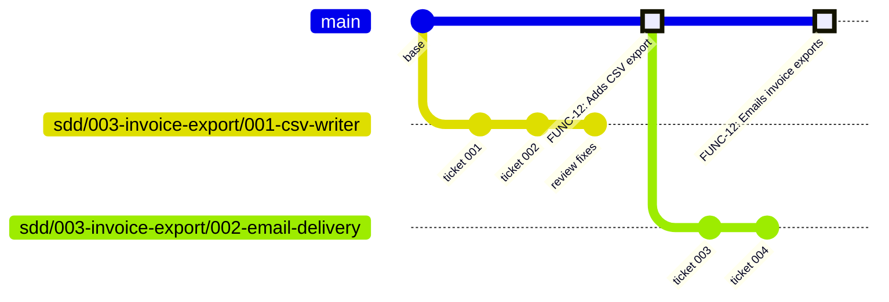

# alper-skills

Spec-driven agent skills for Claude Code, packaged as an installable plugin. They take a feature from a loose idea to reviewed, committed code: you brainstorm it, write it down as a spec, cut the spec into tickets, and build the tickets test-first. You make the decisions. The agent does the digging, writing and building.

## Install

```
/plugin marketplace add alexandrecsp/skills
/plugin install alper-skills@alper
```

The skills then show up as `/alper-skills:<name>`. Below they are written by their short names.

## The pipeline

```
/setup-repository          once per repo: creates .sdd/
        │
/brainstorm  ──────────────  a shared understanding: What, then How
        │
/to-spec  ─────────────────  .sdd/specs/NNN-<slug>/spec.md
        │
/to-tickets  ──────────────  milestones/NNN-<milestone>/ with tickets
        │
/build  (once per milestone) ┐
   ├─ branch <spec>/<milestone> from the base
   ├─ per ticket: sub-agent → tdd → commit
   ├─ check the milestone's "Done when"
   ├─ review-changes → fix
   └─ open the PR → you squash-merge it ┘
```

Each stage writes files the next one reads, and each ends by telling you the next command to run. You can stop between any two stages, or join partway through. For example, `/to-tickets` works on the current conversation without a spec, and `review-changes` works on any branch.

### 0. `/setup-repository`

Prepares the repo. It creates `.sdd/`, which holds everything the pipeline shares and is added to `.gitignore`:

```
.sdd/
├── dashboard.html   ← open in a browser, pick the .sdd folder, see every spec's tickets and status
├── settings.json    ← { "commitKeyPattern": "FUNC-\\d+" } or null
└── specs/
```

`commitKeyPattern` is the regex for an optional key at the start of every commit message, such as a ticket ID. It is safe to run again: a rerun refreshes the dashboard and keeps everything else.

### 1. `/brainstorm [topic]`

The agent interviews you, one round of questions at a time, until you share an understanding of the work. The decisions form a **design tree** with two phases:

- **What** comes first: the problem, scope, behaviour, constraints and what success looks like.
- **How** comes second: the approach, architecture, data and design patterns (via `design-patterns`).

Each round asks every question that can be answered *now*, with options and a recommended answer, so replying `ok` accepts all the recommendations. When a question depends on a fact about the codebase, the agent looks it up instead of asking you. Each phase ends with a summary for you to confirm.

`/brainstorm-with-docs` runs the same interview together with `domain-modeling`. Terms are challenged against `GLOSSARY.md` and written down as they settle, and decisions that are hard to reverse are offered as ADRs in `docs/adr/`.

### 2. `/to-spec`

Turns the conversation into `.sdd/specs/NNN-<slug>/spec.md`. The spec contains only what the conversation settled. Anything left open is recorded as an open question. Before writing, the agent proposes two things for you to confirm:

- the **seams** where tests will prove the feature works, as few as possible
- the **design patterns**, if the brainstorm never weighed them

It also asks for the spec's commit key. The spec covers the problem, solution, user stories and out-of-scope items (the What), then implementation decisions, testing decisions and design patterns (the How).

### 3. `/to-tickets [spec-folder]`

Breaks the spec into ordered **milestones**, and each milestone into **tickets**:

- A milestone is an increment that leaves the code working and tested. It has a check the builder can run.
- A ticket is a **tracer bullet**: a thin vertical slice through every layer it needs, verifiable at a confirmed seam, and small enough for one agent with a fresh context. Prefactoring tickets come first. Wide mechanical refactors follow `WIDE-REFACTOR.md` so each batch stays green.

You review the breakdown (boundaries, granularity, dependencies) until you approve it. Then it writes:

```
.sdd/specs/NNN-<slug>/
├── spec.md
└── milestones/
    └── NNN-<milestone-slug>/
        ├── milestone.md        ← Delivers, Done when, PR: <url>
        └── NNN-<ticket-slug>.md   ← Status: todo | done, Commit: <sha>, Depends on, Notes
```

### 4. `/build [spec-or-milestone-folder]`

Builds **one milestone per run**:

1. It picks the earliest milestone that still has `todo` tickets. It stops when the previous milestone's PR is not merged yet.
2. It checks out the milestone's own branch, `sdd/<spec-folder>/<milestone-folder>`, created from the up-to-date base branch. The working tree must be clean.
3. For each ticket, in order, it starts a fresh **implementer sub-agent**. That sub-agent reads the ticket, the milestone, the spec, and the notes and commits of earlier tickets. It builds the ticket with `tdd` (red, then green, at the ticket's seams) and commits with `commit`. Then it marks the ticket `done` with its SHA and leaves notes for the next ticket.
4. It runs the full suite and the milestone's **Done when** check.
5. It runs `review-changes` over the milestone's whole diff, from the branch's merge-base with the base. Every finding is fixed automatically in one pass, with no second review. It stops to ask you only about findings flagged **escalate**: fixes that would contradict an ADR, change a public interface or a named seam, or need the spec itself changed.
6. After you confirm, it pushes the branch and opens a PR, recording its URL in `milestone.md`.

Squash-merge the PR, then run `/build` again for the next milestone. Because progress lives in the ticket files, a build that stops can pick up where it left off.

#### Branches and merging



Each milestone is one branch, one PR and, after a **squash merge**, one commit on the base branch. The highlighted commits are the squash merges: the next milestone branches from the base only after the previous one lands. The PR's title and body follow the `commit` format, so set the repository's squash commit message to the pull request title and description. After the merge, a ticket's **Commit** names a commit that only the PR still holds. Later tickets that build on it read the milestone's PR diff instead.

Every pipeline branch starts with `sdd/`, so `git branch --list 'sdd/*'` finds them all for cleanup. To have GitHub delete each one when its PR merges, turn on **Automatically delete head branches** in the repository settings; `git fetch --prune` then drops the remote-tracking refs locally.

## Skills used along the way

| Skill | Role |
|---|---|
| `tdd` | Red then green, one vertical slice at a time, with tests only at confirmed seams. |
| `commit` | `<KEY>: <Present-tense title>` plus one to three bullets. Reads the key from the spec. |
| `review-changes` | Reviews a diff in two separate sub-agents. **Standards** checks repo docs, glossary, ADRs and the smell baseline. **Spec** checks for missing requirements, scope creep and requirements built wrong. |
| `domain-modeling` | Maintains `GLOSSARY.md` and ADRs, including multi-context repos with `GLOSSARY-MAP.md`. |
| `design-patterns` | A catalogue of patterns and when to choose each one. Each choice is recorded as Pattern, Where and Why. |
| `codebase-design` | Vocabulary for deep modules: module, interface, seam, adapter, depth. |
| `writing-for-agents` | How to write skills, `CLAUDE.md` and `AGENTS.md`. Used when editing this repo. |
| `research` | Researches a question against primary sources in a background sub-agent. Saves the cited findings to `.sdd/research/<slug>.md`. |
| `prototype` | Builds a throwaway prototype that answers one design question: a shareable HTML demo for logic, or switchable variants for UI. Keeps it on a `prototype/<slug>` branch and records the verdict. |
| `improve-and-refactor` | Scans hot spots for deepening and smell refactors, shows them as an HTML report, and brainstorms the one you pick. A contained refactor goes straight to `/to-tickets` and `/build`; a larger one starts at `/to-spec`. |

The pipeline skills (`setup-repository`, `brainstorm-with-docs`, `to-spec`, `to-tickets`, `build`) and `improve-and-refactor` only run when you type their command. The others can also be invoked by the agent when it needs them.

## Repository layout

```
.claude-plugin/   plugin.json and marketplace.json
skills/<name>/    SKILL.md plus any reference files it points to
```
