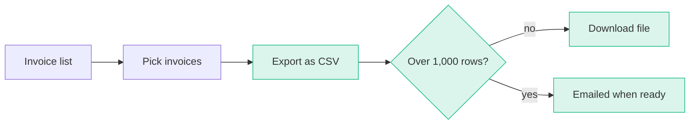
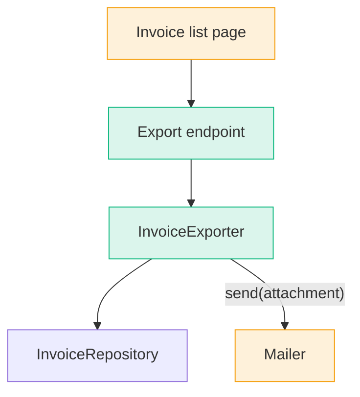
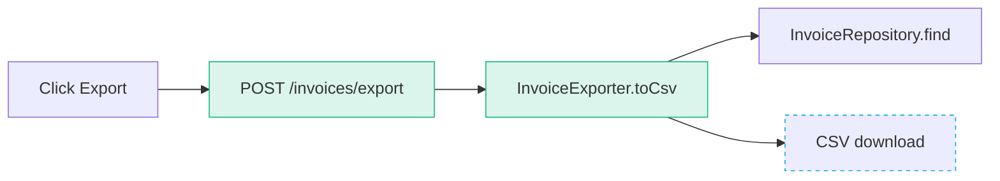
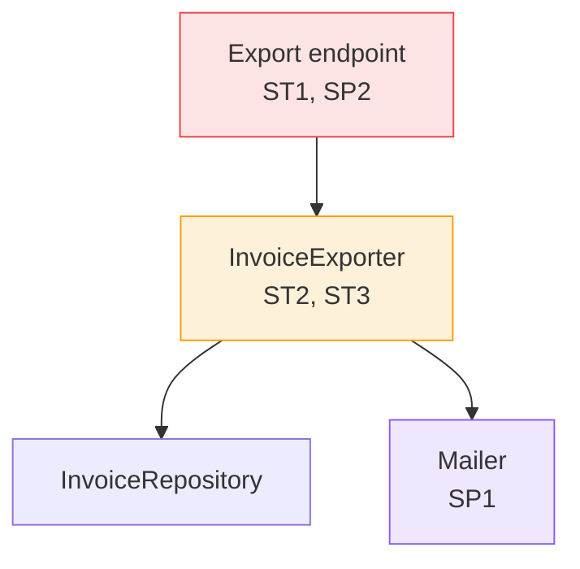
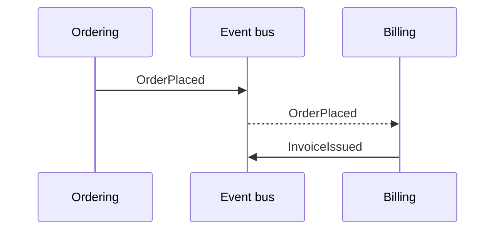

# Diagrams

The pipeline's documents carry Mermaid **diagrams**, so a human sees the **shape** of the work before reading its prose; the dashboard draws each `mermaid` block where it stands, and GitHub draws them in ADRs and PRs. Each template names its diagrams' slots, by the names below.

Draw the **smallest view** that makes the point: one idea per diagram, about a dozen nodes at most, labelled in the glossary's terms, placed right after the sentence it supports. When a diagram needs a paragraph to be understood, redraw the diagram; when prose only retells it, cut the prose.

## Marks

Every diagram marks what the work touches with the same classes, so a reader learns them once. End the diagram with the `classDef` lines it uses, copied as they are:

```text
classDef new stroke:#10b981,fill:#10b98126
classDef changed stroke:#f59e0b,fill:#f59e0b26
classDef seam stroke:#0ea5e9,stroke-dasharray:4 4
classDef violation stroke:#ef4444,fill:#ef444426
classDef judgement stroke:#f59e0b,fill:#f59e0b26
classDef escalate stroke:#8b5cf6,fill:#8b5cf626
```

- `new`: a module, state or step the work builds.
- `changed`: one it changes.
- `seam`: where a test proves the behaviour.
- `violation`, `judgement`, `escalate`: a module's worst finding, in a finding map.
- Unmarked: context the reader needs to place the rest.

Attach a class with `node:::new`, or `class a,b new`. In a `sequenceDiagram`, wrap the new messages in `rect rgba(16, 185, 129, 0.15)` … `end`. In an `erDiagram`, the sentence before it names the new and changed entities.

## Journey

**Where:** `spec.md`, Solution.

The user's path through the feature: a `flowchart LR` of the actions and screens, with a diamond at each decision the user hits, or a `sequenceDiagram` when the feature is an exchange between the user and the system. Mark the steps the feature adds `new`. For work with no user-facing path, such as a refactor, the slot holds one line saying so.



## Module map

**Where:** `spec.md`, Implementation Decisions.

A `flowchart` of the modules the feature builds or changes, plus the unmarked modules they call or are called by. Arrows read "calls" or "sends to"; label one with the interface when that interface changes. When the schema changes, follow it with an `erDiagram` of the entities touched; when a state model changes, with a `stateDiagram-v2`, its new states marked.



## Milestone shape

**Where:** `milestone.md`, Shape.

The spec's module map, with only the modules this milestone builds or changes marked `new` or `changed`, and the rest unmarked: read in order, the milestones fill the map in. Keep the modules that place this milestone's part; drop the rest. When the spec has no module map, draw one for this milestone's modules.

## Tracer bullet

**Where:** a ticket, What to build.

The path the ticket cuts: a `flowchart LR` from its trigger (a user action, a request, an event) through each layer it touches to the outcome, with the node its acceptance criteria test at marked `seam`. One path; add a branch only for an acceptance criterion that tests it.



## Finding map

**Where:** `review.md`, Summary.

A `flowchart` of the modules the diff touches, each labelled with the numbers of its findings and marked by its worst one: `escalate` over `violation` over `judgement`. A Spec finding about a missing requirement sits on the module that should build it. Modules without findings stay unmarked. When the review has no findings, the slot holds the count line alone.



## Decision

**Where:** an ADR, as its Diagram section.

The shape the decision chose: a `flowchart` of the architecture or boundary it fixes, or a `sequenceDiagram` of the integration it settles between contexts. The marks stay off, since an ADR outlives the work that made it. When Considered Options holds a rejected shape worth remembering, draw it too, under its option.



## Findings

**Where:** a research file, under the short answer.

The shape the facts describe, when a reader would otherwise rebuild it from the prose: a `sequenceDiagram` of an API or protocol exchange, a `stateDiagram-v2` of a lifecycle, a `flowchart` of a system's parts or of a decision the sources lay out. Label each step in the source's own terms. The marks stay off. When the answer is a single fact, the slot holds nothing.

## Syntax

The dashboard runs Mermaid 11. A block that fails to parse shows as code with the error under it, so write it to parse first time:

- Give each node a short camelCase id (`exporter`, `invoiceRepo`) and put the name in a quoted label: `exporter["InvoiceExporter.toCsv()"]`. Quoting keeps parentheses, slashes and commas from breaking the parse; the bare word `end` breaks it as an id, so name that node `done`.
- Break a long label with `<br>`; label an edge with `-- "text" -->`.
- One statement per line, and the `classDef` lines last.
